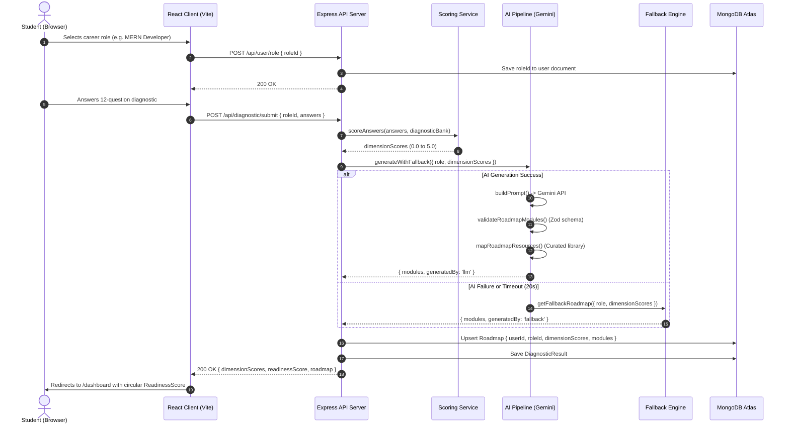
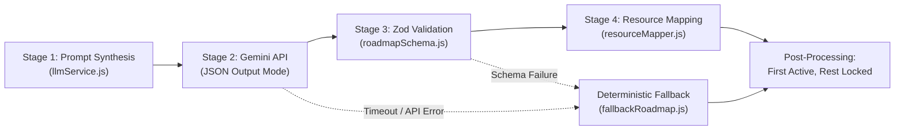
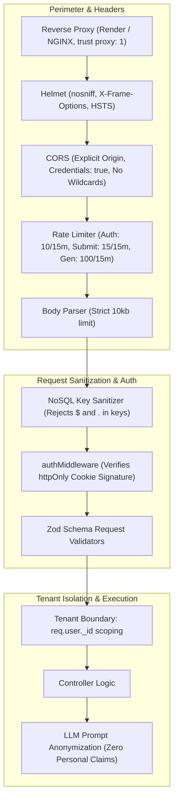

# PathForge Technical Architecture & Deep-Dive Specification

This document details the architectural decisions, pipeline mechanics, and security strategies governing the PathForge platform.

---

## 1. Quiz-to-Roadmap Data Flow



### Flow Breakdown:
1. **Diagnostic Evaluation**:
   - The student submits 12 responses to `POST /api/diagnostic/submit`.
   - `scoringService.js` compares each selected index against the database-stored `correctIndex`.
   - Dimension scores are evaluated on a 0.0 to 5.0 scale:
     $$\text{dimensionScore} = \left(\frac{\text{correctAnswers}}{\text{totalQuestionsInDimension}}\right) \times 5.0$$
2. **Readiness Percentage Computation**:
   - Overall baseline readiness combines initial assessment capability and curriculum completion:
     $$\text{Readiness} = \text{round}\left( 0.4 \times \left(\frac{\text{avgDimensionScore}}{5} \times 100\right) + 0.6 \times \left(\frac{\text{completedHours}}{\text{totalHours}} \times 100\right) \right)$$
3. **Database Upsert**:
   - `Roadmap.findOneAndUpdate({ userId }, { ... }, { upsert: true, new: true })` ensures idempotent, race-condition safe roadmap persistence.

---

## 2. AI Synthesis Pipeline

The curriculum generation pipeline follows a 4-stage validation and resilience architecture:



### Stage 1: Constraint-Enforcing Prompt Construction
- Generated by `buildPrompt()` in `server/services/llmService.js`.
- Ranks evaluated skill dimensions from weakest (lowest score) to strongest (highest score).
- Embeds a strict whitelist of allowed keywords extracted from `data/resources.json`.
- Explicit negative constraints:
  - Strict instruction: Return ONLY raw JSON without conversational filler.
  - Strict instruction: **Never invent or write external URLs**.
  - Strict instruction: Never emit personal data (no names, emails, or IDs).

### Stage 2: Controlled LLM Execution
- Dispatched to Google Gemini 1.5 with `responseMimeType: "application/json"`.
- Uses an `AbortController` bounded by `LLM_TIMEOUT_MS` (default: 20 seconds).
- Defensive response parsing cleans markdown backticks (````json ... ````) before deserialization.

### Stage 3: Zod Schema Validation
- The AST is validated by `validateRoadmapModules()`:
  - Must contain between 5 and 8 modules.
  - `moduleId`: Must be lowercase kebab-case (e.g. `mod-1-react-hooks`) and unique.
  - `title`: String between 3 and 100 characters.
  - `description`: String between 10 and 500 characters.
  - `estimatedHours`: Integer between 1 and 40.
  - `resourceTags`: Non-empty array of tags matching the allowed whitelist.
  - Strict URL rejection: Any markdown link or URL (`http://`, `https://`) in titles or descriptions triggers schema rejection.

### Stage 4: Verified Resource Mapping
- `mapRoadmapResources()` matches module tags against `data/resources.json`.
- Injects up to 3 vetted resources per module (ensuring no duplicate assets).
- If no tags match, automatically supplies the top resources associated with the user's weakest skill dimension.

### Zero-Crash Fallback Guarantee
- Wrapped in a top-level try/catch block.
- On any failure (API error, invalid JSON, Zod validation rejection, timeout, or `FORCE_LLM_FAILURE=true`), the system logs a safe warning and returns `getFallbackRoadmap()`.
- The generator **never throws** an uncaught error to callers.

---

## 3. Security Design & Defense-in-Depth

PathForge enforces multi-layer protection across all application boundaries:



### Key Security Safeguards:
1. **Tenant Isolation**:
   - No endpoint accepts a client-provided `userId`.
   - Data access is bound strictly to `req.user._id` decoded from the verified JWT cookie.
2. **NoSQL Injection Neutralization**:
   - Custom middleware inspects all request bodies, query strings, and route parameters.
   - Any key containing `$` or `.` triggers an immediate HTTP `400 Bad Request` prior to database execution.
3. **Session Cookie Isolation**:
   - Tokens are stored exclusively in `httpOnly`, `Secure` (in production), `SameSite=Lax` / `None` cookies.
   - Client scripts cannot access `document.cookie`, completely eliminating token theft via XSS.
4. **Assessment Anti-Cheat**:
   - `GET /api/diagnostic/:roleId` strictly strips `correctIndex` and explanation metadata before returning questions.
5. **Sanitized Error Handling**:
   - Centralized error handler redacts raw database errors and suppresses stack traces in all production responses.
